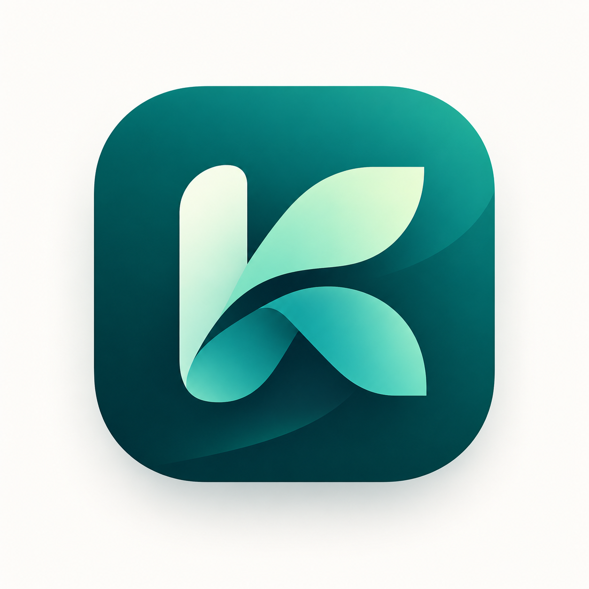

# Kizuvia

<p align="center">
  
</p>

<p align="center">
  <strong>Care that connects.</strong>
</p>

<p align="center">
  A cross-platform mobile application for family medication and care management, built with an <strong>offline-first</strong> architecture, cross-device caregiver synchronization powered by Supabase and Firebase Cloud Messaging (FCM), and on-device pharmacy label scanning (OCR).
</p>

<p align="center">
  
  
  
  
  
  
  
</p>

---

## Table of Contents

- [About Kizuvia](#about-kizuvia)
- [Problems Addressed](#problems-addressed)
- [Key Features](#key-features)
- [Medical Safety and Privacy Principles](#medical-safety-and-privacy-principles)
- [Technology Stack](#technology-stack)
- [System Architecture](#system-architecture)
- [Directory Structure](#directory-structure)
- [Getting Started](#getting-started)
  - [Prerequisites](#prerequisites)
  - [Installation](#installation)
  - [Environment Configuration](#environment-configuration)
  - [Code Generation and Localization](#code-generation-and-localization)
  - [Running the Application](#running-the-application)
- [Testing and Code Quality](#testing-and-code-quality)
- [Documentation Reference](#documentation-reference)
- [Medical Disclaimer](#medical-disclaimer)

---

## About Kizuvia

**Kizuvia** (inspired by the Japanese concept of *kizuna*, meaning bonds or connection, and the Latin *via*, meaning path or journey) is a mobile application engineered to help families manage complex medication regimens with clarity, peace of mind, and accessibility. 

Kizuvia bridges the gap between **patients** (especially seniors and individuals with chronic conditions who require dependable, accessible dose schedules) and **caregivers** (such as adult children living remotely or co-habitating family members) who need reliable visibility into treatment adherence.

---

## Problems Addressed

- **Complex Multi-Dose Regimens**: Patients managing chronic conditions (e.g., stroke recovery, hypertension, diabetes, cardiac disease) frequently take 4 to 10 distinct medications per day across varying times and meal requirements.
- **Cognitive and Physical Limitations**: Seniors and vulnerable patients face risks of skipped doses, incorrect pills, or accidental double dosing due to declining eyesight or confusion.
- **Remote Caregiver Anxiety**: Family members living in different locations have limited visibility into whether their loved ones are adhering to their daily medication schedules.
- **Unplanned Medication Depletion**: Patients regularly run out of critical prescriptions prior to doctor checkups due to lack of inventory monitoring.
- **Lack of Objective Adherence Records**: Healthcare providers often lack verifiable compliance data during clinical consultations to evaluate treatment efficacy.

---

## Key Features

### 1. Reliable Offline-First Alarms and Reminders
- **Zero Network Dependency**: Schedule evaluation and alarm execution operate entirely on the local device using `flutter_local_notifications`.
- **Direct Notification Actions**: Confirm intake directly from lock screens and system notifications without opening the app:
  - `Taken` (logs adherence timestamp and decrements medication stock)
  - `Snooze 10 Minutes` (reschedules reminder)
  - `Skip` (records non-adherence with optional rationale)
- **OEM Battery Optimization Guide**: Integrated setup instructions for aggressive manufacturer battery management systems (e.g., Xiaomi, Samsung, Oppo, Vivo) to ensure background alarms fire reliably.

### 2. Family Circle and Remote Caregiver Sync
- **Multi-Patient Support**: Manage multiple patient profiles under a single family group.
- **Missed-Dose Alerts**: Remote caregivers receive automated push notifications via Supabase Edge Functions and Firebase Cloud Messaging when a scheduled dose remains unconfirmed past the configured grace period.
- **Proxy Confirmations**: In-home caregivers can log doses on behalf of patients who are unable to operate a smartphone.
- **Seamless Family Onboarding**: Connect family members securely using invitation codes or deep links.

### 3. Smart Pharmacy Label Scanner (OCR)
- **Automated Text Extraction**: Capture prescription label photos using Google ML Kit Text Recognition.
- **Intelligent Parsing**: Automatically parses Indonesian prescription label conventions (medication names via local pharmaceutical index, frequency templates such as *3x daily 1 tablet after meals*, dates, and patient identifiers) into a structured draft form.
- **Human-in-the-Loop Verification**: All OCR results remain drafts that require explicit user review and confirmation before being committed.

### 4. Medication Inventory and Refill Tracking
- **Automatic Stock Decrement**: Inventory automatically adjusts each time a dose is recorded as taken.
- **Low-Stock Warnings**: Proactive alerts when remaining doses drop below a defined threshold ($\le N$ days), providing ample time to refill prescriptions before run-out.

### 5. Adherence History and PDF Export
- **Adherence Analytics**: Visual compliance calendar with percentage tracking per patient and per prescription.
- **Structured PDF Reports**: Export printable adherence summaries to share with doctors and pharmacists during consultations.

### 6. Accessibility and Senior-Friendly Design
- **Inclusive Design Standards**: Large touch targets ($\ge 48\text{dp}$), high-contrast palettes adhering to WCAG AA, and system font scaling support up to 200%.
- **Physical Pill Visuals**: Medication detail views feature real photographic references to prevent confusion between similar-looking tablets.
- **Lock Screen Privacy**: Optional privacy toggle to conceal medication names and dosages from public lock screen notifications.

---

## Medical Safety and Privacy Principles

1. **Non-Diagnostic Scope**: Kizuvia is strictly an administrative scheduling and adherence tracking utility. The application **never** recommends medications, diagnoses conditions, calculates clinical dosages, or provides automated drug interaction alerts.
2. **User Authority**: All medication data originates from authorized prescriptions input or approved by the user. OCR extraction serves exclusively as an editable draft.
3. **Data Protection and Zero Leakage**:
   - Patient health information is safeguarded through Row-Level Security (RLS) on PostgreSQL tables within Supabase.
   - Personally identifiable health data is strictly excluded from release logs, telemetry, crash reporting services, and third-party trackers.
   - The Supabase Service Role Key is never bundled into or accessible by client binaries.

---

## Technology Stack

| Category | Technology / Library |
|---|---|
| **Framework and Language** | [Flutter](https://flutter.dev) 3.x, [Dart](https://dart.dev) 3.x |
| **State Management** | [Flutter Riverpod](https://riverpod.dev) (Annotations & Code Generation) |
| **Local Database** | [Drift](https://drift.simonbinder.eu/) (SQLite) with relational schema and local sync queue |
| **Backend & Cloud** | [Supabase](https://supabase.com) (Auth, PostgreSQL, Row-Level Security, Storage, Edge Functions) |
| **Push Notifications** | [Firebase Cloud Messaging (FCM)](https://firebase.google.com/docs/cloud-messaging) |
| **Local Alarms** | `flutter_local_notifications`, `timezone` |
| **Routing** | [GoRouter](https://pub.dev/packages/go_router) |
| **On-Device Vision** | [Google ML Kit Text Recognition](https://pub.dev/packages/google_mlkit_text_recognition) |
| **Reporting** | `pdf`, `printing`, `share_plus` |
| **Code Generation** | `freezed`, `riverpod_generator`, `drift_dev`, `build_runner` |
| **Design System** | Material 3 with custom tokens (`AppColors`, `AppTypography` with Plus Jakarta Sans) |

---

## System Architecture

Kizuvia adopts a **Feature-First** modular structure combined with an **Offline-First** operational paradigm.

```
lib/
├── app/                  # Application bootstrap, routing (GoRouter), and global theming
│   ├── theme/            # Design tokens (colors, typography, radii, spacing)
│   ├── app.dart          # Root application widget
│   └── router.dart       # Route hierarchy and navigation guards
├── core/                 # Shared infrastructure across all features
│   ├── clock/            # Clock abstraction for testable time calculations
│   ├── db/               # Drift SQLite database, local schema, DAOs, sync queue
│   ├── domain/           # Shared domain models, enums, value objects
│   ├── errors/           # AppFailure definitions and Result monads
│   ├── notifications/    # Local notification gateway and background alarm handlers
│   ├── push/             # FCM push token registration and handlers
│   ├── supabase/         # Supabase client singletons and providers
│   ├── sync/             # Two-way synchronization engine (Drift <-> Supabase)
│   ├── utils/            # Shared formatting and utility extensions
│   └── widgets/          # Shared atomic widgets (accessible cards, large buttons)
├── features/             # Business modules (Data, Domain, Presentation layers)
│   ├── auth/             # Authentication, session lifecycle, onboarding gates
│   ├── dose_log/         # Dose logging, adherence records, and action processing
│   ├── family/           # Family group management and caregiver linking
│   ├── history/          # Historical compliance analytics and calendar visualizer
│   ├── home/             # "Today" dashboard and upcoming daily dose schedule
│   ├── medications/      # Medication registry, frequency schedules, and photo capture
│   ├── onboarding/       # Setup walkthrough, permission handlers, OEM battery guide
│   ├── patients/         # Patient profile lifecycle management
│   ├── reports/          # PDF report generator and system sharing
│   ├── scan/             # ML Kit label OCR pipeline and prescription parsing
│   ├── settings/         # Alarm preferences, notification privacy, test panel
│   └── stock/            # Medication inventory calculations and depletion projections
└── l10n/                 # Localization assets (Indonesian primary locale)
```

### Data Flow Overview:
1. **Presentation Layer**: Consumes state and dispatches user actions through Riverpod Notifiers and AsyncNotifiers.
2. **Domain Layer**: Enforces business rules and manages immutable domain entities generated with `freezed`.
3. **Local Store (Drift SQLite)**: Serves as the primary source of truth for all UI reads. Write operations commit locally before network transmission.
4. **Sync Queue**: Local mutations produce synchronization events queued in SQLite and dispatched to Supabase when network connectivity is available.

---

## Getting Started

### Prerequisites
- [Flutter SDK](https://docs.flutter.dev/get-started/install) (version 3.24+ recommended)
- [Dart SDK](https://dart.dev/get-dart) (^3.14.0)
- Android Studio / Xcode configured with an emulator or physical device (a physical mobile device is strongly recommended for testing alarms, background tasks, and camera OCR)

### Installation

1. Clone the repository:
   ```bash
   git clone https://github.com/username/kizuvia.git
   cd kizuvia
   ```

2. Fetch project dependencies:
   ```bash
   flutter pub get
   ```

### Environment Configuration

Create your environment configuration files based on `env.example.json`:

```bash
cp env.example.json env.dev.json
```

Populate the required credentials:
```json
{
  "SUPABASE_URL": "https://your-project.supabase.co",
  "SUPABASE_ANON_KEY": "your-anon-key",
  "SENTRY_DSN": ""
}
```

> **Important**: Do not commit private API keys or Supabase `service_role` credentials into client application code or version control.

### Code Generation and Localization

Run the generation pipeline to produce code for Freezed models, Riverpod providers, Drift tables, and localization classes:

```bash
# Generate localization classes from ARB files
flutter gen-l10n

# Run build_runner for code generation
dart run build_runner build --delete-conflicting-outputs
```

### Running the Application

Run the application targeting the development environment flavor:

```bash
flutter run --flavor dev --dart-define-from-file=env.dev.json
```

To assemble a split-ABI release APK for production testing:
```bash
flutter build apk --release --flavor prod --split-per-abi --dart-define-from-file=env.prod.json
```

---

## Testing and Code Quality

Run tests, static analysis, and code formatting checks:

```bash
# Run unit and widget test suite
flutter test

# Execute static analysis
flutter analyze

# Verify code formatting
dart format --output=none --set-exit-if-changed .
```

> **Testing Alarms on Physical Devices**: Use the debug verification screen at **Settings > Test Alarm** (available only in debug builds) to confirm that alarm channels, audio streams, and waking locks function reliably across target device brands.

---

## Documentation Reference

Detailed architectural and engineering documentation is maintained in the [`docs/`](file:///d:/dev/kizuvia/docs) directory:

| Document | Description |
|---|---|
| [`00-BRAND-IDENTITY.md`](file:///d:/dev/kizuvia/docs/00-BRAND-IDENTITY.md) | Brand guidelines, tone of voice, color palette, typography tokens, and visual assets |
| [`01-PRD.md`](file:///d:/dev/kizuvia/docs/01-PRD.md) | Product Requirements Document, target personas, functional requirements, and non-goals |
| [`02-ARCHITECTURE.md`](file:///d:/dev/kizuvia/docs/02-ARCHITECTURE.md) | Comprehensive system architecture, layer dependency rules, and architectural decision records (ADRs) |
| [`03-DATABASE.md`](file:///d:/dev/kizuvia/docs/03-DATABASE.md) | Relational schema definitions (Drift SQLite & PostgreSQL), Row-Level Security policies, and RPC functions |
| [`04-NOTIFICATIONS.md`](file:///d:/dev/kizuvia/docs/04-NOTIFICATIONS.md) | Local alarm scheduling, snooze state machine, OEM battery workarounds, and FCM push notifications |
| [`05-SYNC.md`](file:///d:/dev/kizuvia/docs/05-SYNC.md) | Two-way offline-first sync engine, conflict resolution rules, and queuing protocols |
| [`06-SCAN-OCR.md`](file:///d:/dev/kizuvia/docs/06-SCAN-OCR.md) | Google ML Kit on-device vision pipeline, Indonesian pharmacy label parser, and validation heuristics |
| [`07-UI-FLOW.md`](file:///d:/dev/kizuvia/docs/07-UI-FLOW.md) | User journeys, screen wireflows, state specifications, and senior accessibility standards |
| [`08-SECURITY-PRIVACY.md`](file:///d:/dev/kizuvia/docs/08-SECURITY-PRIVACY.md) | Patient data privacy policies, PII handling restrictions, secure token storage, and authentication rules |
| [`09-TESTING.md`](file:///d:/dev/kizuvia/docs/09-TESTING.md) | Automated testing strategy, mock implementations, CI pipeline, and Definition of Done (DoD) |
| [`10-ROADMAP.md`](file:///d:/dev/kizuvia/docs/10-ROADMAP.md) | Phased project development milestones from MVP through post-release capabilities |

---

## Medical Disclaimer

> **Kizuvia is an administrative medication schedule and family care coordination tool.**  
> The application does **NOT** provide medical diagnosis, treatment recommendations, customized clinical dosage instructions, or pharmaceutical interaction assessments. Users must always adhere to the explicit instructions provided by licensed physicians, pharmacists, and official healthcare professionals regarding all medication usage and care routines.
