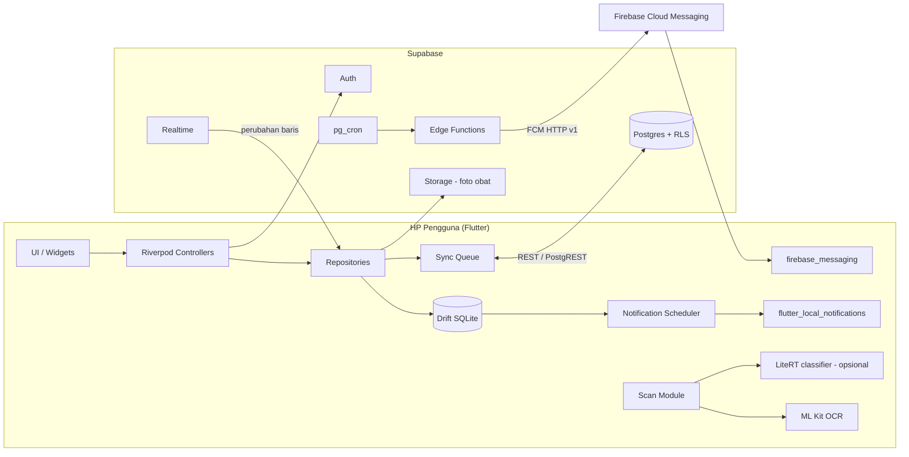
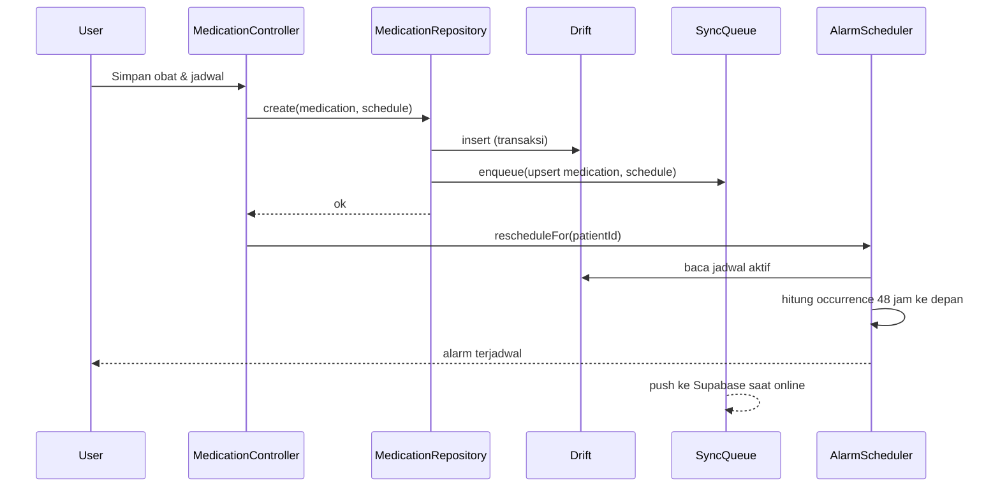
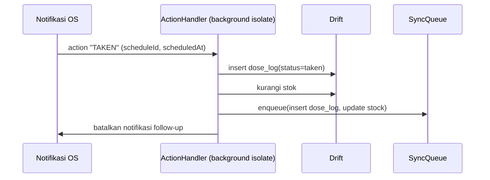
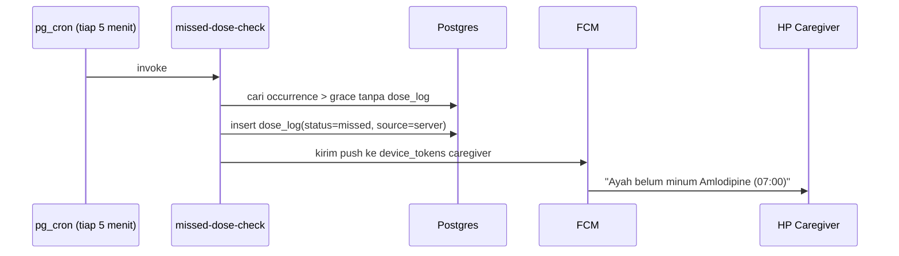

# 02 — Arsitektur Sistem

## 1. Gambaran besar



Prinsip:
1. **Offline-first**: Drift adalah sumber data untuk UI. Supabase adalah sumber sinkronisasi antar perangkat.
2. **Alarm 100% lokal**: penjadwalan alarm tidak pernah menunggu jaringan.
3. **Server hanya untuk hal yang tidak bisa dilakukan perangkat**: sinkronisasi, deteksi dosis terlewat
   lintas perangkat, dan push ke caregiver.

## 2. Lapisan aplikasi (Flutter)

```
presentation  →  Screens, Widgets, Controllers (Riverpod Notifier/AsyncNotifier)
domain        →  Entities (freezed), Use cases (hanya jika logika > 1 repository)
data          →  Repositories, LocalDataSource (Drift DAO), RemoteDataSource (Supabase), DTO
core          →  DB, Supabase client, Notifications, Sync engine, Logger, Clock
```

Aturan dependensi:
- `presentation` hanya bergantung pada `domain` dan provider repository.
- `domain` tidak mengimpor Flutter, Drift, atau Supabase.
- `data` mengimplementasi interface repository di `domain`.
- Semua akses waktu lewat `Clock` provider (agar bisa di-mock di test).

## 3. Struktur folder

```
lib/
  main.dart                   # memanggil bootstrap()
  bootstrap.dart              # tz, SharedPreferences, notifikasi, Supabase, Firebase (tanpa menunda alarm)
  firebase_options.dart       # dibuat `flutterfire configure` (jangan ditimpa)
  app/
    app.dart                  # MaterialApp.router, observer lifecycle (resume -> reschedule + sync)
    router.dart               # go_router, redirect onboarding, deep link kizuvia://invite/{code}
    theme/                    # AppPalette, AppTokens, AppTheme (light, dark, lansia)
  core/
    clock/  errors/  utils/   # Clock, Result/AppFailure, AppLogger (redaksi)
    domain/enums.dart         # enum murni dipakai domain & data
    db/                       # Drift: app_database, tables/, sync_enqueue.dart
    notifications/            # occurrence_calculator, alarm_scheduler, dose_actions,
                              # notification_service/actions/payload/providers, system_settings
    supabase/supabase_config.dart
    sync/                     # sync_engine, sync_remote, sync_controller, account_migrator, photo_sync
    push/push_registrar.dart  # token FCM/FID -> device_tokens
    widgets/                  # EmptyState, StatusChip, AppBanner
  features/                   # tiap fitur: domain/ data/ presentation/ (sesuai kebutuhan)
    onboarding/ patients/ medications/ dose_log/ stock/ history/ home/
    settings/ auth/ family/ scan/ reports/ dev/(debug saja)
  l10n/                       # app_id.arb (+ gen/ hasil `flutter gen-l10n`)
supabase/
  migrations/                 # SQL; diterapkan via MCP ke project dev
  tests/rls_test.sql          # pgTAP, dijalankan di cloud dengan rollback
  functions/
    missed-dose-check/        # index.ts + push.ts (FCM HTTP v1)
    low-stock-check/          # index.ts + push.ts (salinan)
assets/
  fonts/ logo/ drug_names.txt ATTRIBUTION.md
drift_schemas/                # dump skema Drift per versi (untuk test migrasi)
test/  integration_test/
```

## 4. Alur data utama

### 4.1 Membuat obat + jadwal


### 4.2 Alarm berbunyi → konfirmasi


### 4.3 Dosis terlewat → caregiver


Catatan: occurrence dihitung di server dari `schedules` (fungsi SQL `expand_occurrences(from, to)`),
**bukan** dari alarm di perangkat, sehingga tetap terdeteksi walaupun HP pasien mati.

## 5. State management (Riverpod)
- Gunakan `@riverpod` code generation.
- Stream dari Drift (`watch...()`) dibungkus `StreamProvider` agar UI reaktif dan otomatis terupdate setelah sync.
- Controller form memakai `AsyncNotifier` dan mengembalikan `AsyncValue`.
- Jangan simpan state UI sementara (misalnya input form) di provider global.

## 6. Navigasi (go_router)
- `redirect` berdasarkan status auth dan apakah user sudah punya keluarga.
- Deep link `kizuvia://invite/{code}` dan `https://<domain>/invite/{code}` → layar terima undangan.
- Tap notifikasi → `/dose/{scheduleId}?at={iso}`.

## 7. Error handling & logging
- Repository mengembalikan `Result<T, AppFailure>` (sealed class), bukan melempar exception ke UI.
- Logger dengan level; di release tidak mencetak data pasien/obat.
- Crash reporting (Sentry/Crashlytics) dengan scrubbing nama obat dan pasien.

## 8. Konfigurasi & environment
- `env.dev.json`, `env.prod.json` → `--dart-define-from-file` (di-.gitignore).
- Isi: `SUPABASE_URL`, `SUPABASE_ANON_KEY` (kunci publishable/anon, publik), `SENTRY_DSN` (belum dipakai).
- Tanpa env file, aplikasi jalan dalam mode lokal (tanpa akun/sync); alarm tidak terpengaruh.
- Secret server (Supabase Edge Functions): `FCM_SERVICE_ACCOUNT`. Rahasia cron ada di Supabase Vault (`cron_secret`, `project_url`).
- Service role key **hanya** di Edge Function secrets, tidak pernah di app.

## 9. Keputusan arsitektur (ADR singkat)
| # | Keputusan | Alasan | Alternatif |
|---|---|---|---|
| ADR-1 | Supabase sebagai BE | Postgres + RLS cocok untuk data relasional keluarga; SQL familiar | Firebase Firestore |
| ADR-2 | Drift untuk lokal | Relasional, type-safe, query reaktif, migrasi | Isar, Hive |
| ADR-3 | FCM untuk push | Gratis, Android+iOS; Supabase belum punya push native | OneSignal |
| ADR-4 | ML Kit untuk OCR | On-device, gratis, akurat untuk teks cetak | Model OCR LiteRT custom |
| ADR-5 | LiteRT hanya untuk klasifikasi gambar | OCR sudah ditangani ML Kit | — |
| ADR-6 | Riverpod | Testable, compile-safe, cocok dengan stream Drift | Bloc |
| ADR-7 | Last-write-wins + log append-only | Sederhana; konflik jarang di skala keluarga | CRDT |
| ADR-8 | `flutter_launcher_icons` + `flutter_native_splash` (dev dependency, hanya build-time) | Generate icon & splash native dari satu sumber di `assets/logo/` | Edit manual XML/storyboard/mipmap |
| ADR-10 | `home_widget` (T3.4) | Widget home screen Android tanpa menulis channel sendiri | Method channel + AppWidgetProvider manual |
| ADR-11 | `flutter_secure_storage`, `local_auth`, `sqlite3` (build SQLCipher) (T3.5) | Kunci DB di Keystore; kunci aplikasi memakai biometrik/PIN perangkat (tanpa PIN buatan sendiri); `sqlite3` jadi dependency langsung untuk migrasi DB lama | `sqlcipher_flutter_libs` (EOL, tidak cocok dengan sqlite3 3.x) |
| ADR-9 | `material_ui` (bukan `flutter/material.dart`) | Paket Material resmi terpisah dari framework sejak Flutter 3.47; sudah dipakai template proyek. `GlobalMaterialLocalizations.delegates` dari paket ini sudah menyertakan delegate Cupertino & Widgets | `package:flutter/material.dart` (deprecated) |
| ADR-10 | Paket Fase 0: `flutter_riverpod`, `riverpod_annotation`/`riverpod_generator`, `go_router`, `drift`/`drift_flutter`/`drift_dev`, `build_runner`, `path`, `path_provider`, `intl`, `flutter_localizations`, `mocktail` (dev) | Sesuai stack CLAUDE.md; `freezed` dipakai untuk entity domain sejak Fase 1 | — |
| ADR-11 | Paket Fase 1: `uuid` (id klien), `timezone` + `flutter_timezone` (jadwal per zona waktu), `flutter_local_notifications` (alarm), `shared_preferences` (preferensi non-kesehatan, juga dibaca isolate background), `image_picker` (foto obat), `freezed`/`freezed_annotation` | Kebutuhan T1.x | `permission_handler` ditunda: izin notifikasi & exact alarm sudah lewat plugin notifikasi |
| ADR-12 | `firebase_core` (init saja, T2.6 sebagian) | Init Firebase dari `bootstrap`, dibungkus try/catch dan tidak pernah menunda start (alarm tidak bergantung Firebase). `lib/firebase_options.dart` dibuat `flutterfire configure` (jangan ditimpa). Flavor dev memakai id yang sama dengan prod (`com.igz.kizuvia`) sampai `com.igz.kizuvia.dev` didaftarkan di Firebase | — |
| ADR-13 | Paket Fase 2: `supabase_flutter` (auth/RPC/realtime/storage), `firebase_messaging` (token caregiver), `share_plus` (bagikan kode & PDF), `google_mlkit_text_recognition` (OCR on-device), `pdf` (laporan, Dart murni) | T2.2–T2.11 | `printing` (tidak perlu; hanya bagikan berkas), `image_cropper` (ditunda; butuh activity Android tambahan) |
