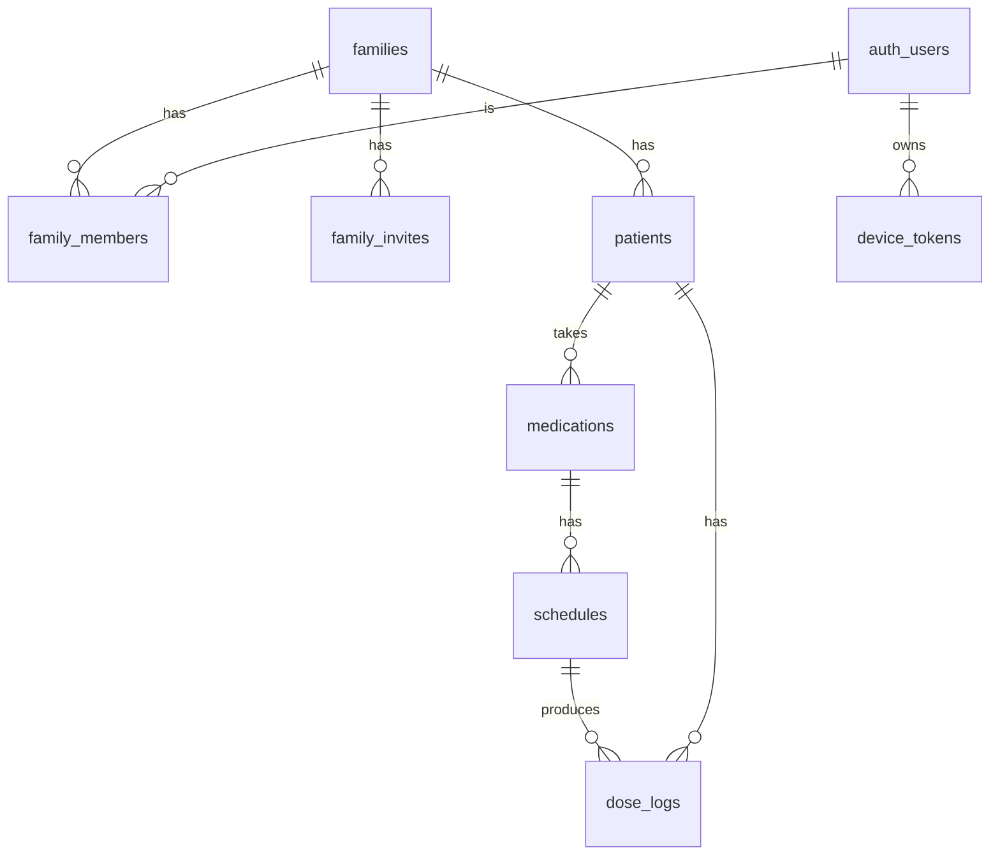

# 03 — Database (Supabase Postgres + Drift)

## 1. ERD



## 2. Migrasi awal (`supabase/migrations/0001_init.sql`)

```sql
create extension if not exists "pgcrypto";

-- ===== Keluarga =====
create table public.families (
  id uuid primary key default gen_random_uuid(),
  name text not null,
  created_by uuid not null references auth.users(id),
  created_at timestamptz not null default now(),
  updated_at timestamptz not null default now()
);

create table public.family_members (
  family_id uuid not null references public.families(id) on delete cascade,
  user_id uuid not null references auth.users(id) on delete cascade,
  role text not null check (role in ('owner','caregiver','patient')),
  display_name text,
  notify_missed boolean not null default true,
  joined_at timestamptz not null default now(),
  primary key (family_id, user_id)
);

create table public.family_invites (
  id uuid primary key default gen_random_uuid(),
  family_id uuid not null references public.families(id) on delete cascade,
  code text not null unique,
  role text not null check (role in ('caregiver','patient')),
  created_by uuid not null references auth.users(id),
  expires_at timestamptz not null default now() + interval '7 days',
  used_by uuid references auth.users(id),
  used_at timestamptz
);

-- ===== Pasien =====
create table public.patients (
  id uuid primary key,
  family_id uuid not null references public.families(id) on delete cascade,
  user_id uuid references auth.users(id),
  name text not null,
  birth_year int,
  conditions text[] not null default '{}',
  notes text,
  photo_path text,
  updated_at timestamptz not null default now(),
  deleted_at timestamptz
);

-- ===== Obat =====
create table public.medications (
  id uuid primary key,
  patient_id uuid not null references public.patients(id) on delete cascade,
  name text not null,
  strength text,
  form text check (form in ('tablet','kapsul','sirup','tetes','salep','injeksi','inhaler','lainnya')),
  instructions text,
  meal_relation text check (meal_relation in ('sebelum_makan','sesudah_makan','bersama_makan','bebas')),
  prescribed_by text,
  stock_qty numeric,
  dose_qty numeric not null default 1,
  refill_threshold_days int not null default 3,
  photo_path text,
  start_date date not null default current_date,
  end_date date,
  is_prn boolean not null default false,       -- "bila perlu", tanpa alarm
  is_active boolean not null default true,
  source text not null default 'manual' check (source in ('manual','scan')),
  updated_at timestamptz not null default now(),
  deleted_at timestamptz
);

-- ===== Jadwal =====
create table public.schedules (
  id uuid primary key,
  medication_id uuid not null references public.medications(id) on delete cascade,
  times time[] not null,
  days_of_week int[] not null default '{1,2,3,4,5,6,7}',  -- ISO: 1=Senin
  timezone text not null default 'Asia/Jakarta',
  grace_minutes int not null default 30,
  updated_at timestamptz not null default now(),
  deleted_at timestamptz
);

-- ===== Log dosis (append-only) =====
create table public.dose_logs (
  id uuid primary key,
  schedule_id uuid not null references public.schedules(id) on delete cascade,
  patient_id uuid not null references public.patients(id) on delete cascade,
  scheduled_at timestamptz not null,
  status text not null check (status in ('taken','skipped','missed')),
  confirmed_by uuid references auth.users(id),
  confirmed_at timestamptz,
  source text not null default 'device' check (source in ('device','server')),
  note text,
  created_at timestamptz not null default now(),
  unique (schedule_id, scheduled_at, status)
);

-- ===== Push token =====
create table public.device_tokens (
  token text primary key,
  user_id uuid not null references auth.users(id) on delete cascade,
  platform text check (platform in ('android','ios')),
  updated_at timestamptz not null default now()
);

-- ===== Index =====
create index on public.patients (family_id);
create index on public.medications (patient_id);
create index on public.schedules (medication_id);
create index on public.dose_logs (patient_id, scheduled_at desc);
create index on public.patients (updated_at);
create index on public.medications (updated_at);
create index on public.schedules (updated_at);

-- ===== Trigger updated_at =====
create or replace function public.touch_updated_at() returns trigger
language plpgsql as $$ begin new.updated_at = now(); return new; end $$;

create trigger t_patients before update on public.patients
  for each row execute function public.touch_updated_at();
create trigger t_medications before update on public.medications
  for each row execute function public.touch_updated_at();
create trigger t_schedules before update on public.schedules
  for each row execute function public.touch_updated_at();
```

> Catatan: `dose_logs` memiliki unique `(schedule_id, scheduled_at, status)`. Jika server sudah menulis
> `missed` lalu pasien mengonfirmasi `taken` belakangan, keduanya disimpan; status efektif = `taken`
> (lihat 05-SYNC.md §4).

## 3. Row Level Security (`0002_rls.sql`)

```sql
create or replace function public.is_family_member(fid uuid)
returns boolean language sql stable security definer set search_path = public as $$
  select exists (select 1 from family_members where family_id = fid and user_id = auth.uid());
$$;

create or replace function public.patient_family(pid uuid)
returns uuid language sql stable security definer set search_path = public as $$
  select family_id from patients where id = pid;
$$;

create or replace function public.medication_family(mid uuid)
returns uuid language sql stable security definer set search_path = public as $$
  select p.family_id from medications m join patients p on p.id = m.patient_id where m.id = mid;
$$;

alter table families        enable row level security;
alter table family_members  enable row level security;
alter table family_invites  enable row level security;
alter table patients        enable row level security;
alter table medications     enable row level security;
alter table schedules       enable row level security;
alter table dose_logs       enable row level security;
alter table device_tokens   enable row level security;

-- families
create policy fam_select on families for select using (is_family_member(id));
create policy fam_insert on families for insert with check (created_by = auth.uid());
create policy fam_update on families for update using (
  exists (select 1 from family_members where family_id = id and user_id = auth.uid() and role = 'owner'));

-- family_members
create policy fm_select on family_members for select using (is_family_member(family_id));
-- insert member hanya lewat RPC accept_invite / create_family (security definer)

-- patients
create policy pat_all on patients for all
  using (is_family_member(family_id)) with check (is_family_member(family_id));

-- medications
create policy med_all on medications for all
  using (is_family_member(patient_family(patient_id)))
  with check (is_family_member(patient_family(patient_id)));

-- schedules
create policy sch_all on schedules for all
  using (is_family_member(medication_family(medication_id)))
  with check (is_family_member(medication_family(medication_id)));

-- dose_logs: baca & insert saja
create policy dl_select on dose_logs for select using (is_family_member(patient_family(patient_id)));
create policy dl_insert on dose_logs for insert with check (
  is_family_member(patient_family(patient_id)) and source = 'device');

-- device_tokens: milik sendiri
create policy dt_all on device_tokens for all using (user_id = auth.uid()) with check (user_id = auth.uid());
```

### RPC (security definer)
- `create_family(name text) returns uuid` — buat keluarga + owner dalam satu transaksi.
- `create_invite(family_id uuid, role text) returns text` — hanya owner; kode 6 karakter (tanpa 0/O/1/I).
- `accept_invite(code text) returns uuid` — validasi kedaluwarsa, insert member, tandai used.
- `remove_member(family_id uuid, user_id uuid)` — hanya owner; owner terakhir tidak boleh keluar.
- `expand_occurrences(from_ts timestamptz, to_ts timestamptz)` — menghasilkan
  `(schedule_id, patient_id, scheduled_at)` dari `schedules` untuk Edge Function.

## 4. Storage
- Bucket `medication-photos` (private).
- Path: `{family_id}/{patient_id}/{medication_id}/{uuid}.jpg`.
- Policy storage: `is_family_member((storage.foldername(name))[1]::uuid)`.
- Kompres ke maks. 1280px, JPEG kualitas 80 sebelum upload.

## 5. Mirror lokal (Drift)
Tabel Drift meniru tabel server, plus kolom lokal:

| Kolom | Fungsi |
|---|---|
| `sync_status` | `synced` / `pending` / `failed` |
| `local_updated_at` | waktu edit lokal (untuk resolusi konflik) |

Tabel tambahan lokal saja:
- `sync_queue(id, target_table, row_id, op, payload_json, attempts, last_error, created_at)` (kolom `target_table`, bukan `table_name`: bentrok dengan `Table.tableName` di Drift; sama untuk `sync_cursor.target_table`)
- `scheduled_notifications(notification_id, schedule_id, scheduled_at)` — untuk membatalkan atau menjadwalkan ulang.
- `sync_cursor(target_table, last_pulled_at)`.

Migrasi Drift: setiap perubahan skema menaikkan `schemaVersion` dan menambah langkah `MigrationStrategy`;
wajib ada test migrasi (`drift_dev schema dump` + `SchemaVerifier`).

Skema Drift v1 di-dump ke `drift_schemas/`; test `test/core/db/migration_test.dart` memverifikasinya.
`patients.family_id` nullable di lokal (data belum terhubung ke akun, lihat T2.3).

## 6. Catatan implementasi Fase 2
- Skema server dikelola lewat migrasi di `supabase/migrations/` (diterapkan via MCP ke project `kizuviadev`). Ada beberapa penyimpangan dari draf di atas yang disengaja:
  helper RLS di schema `private`, `dose_logs` hanya menerima `taken`/`skipped` dari klien (`missed` hanya dari server), tabel `private.push_log`,
  RPC tambahan (`set_member_role`, `my_families`, `delete_my_account_data`, `find_missed_doses`, `find_low_stock`, `record_push`, `push_recipients`, `get_cron_secret`).
- `find_missed_doses` mengabaikan dosis sebelum baris obat dibuat di server (`start_date` hanya tanggal; tanpa ini obat yang ditambah jam 14.00 memicu "terlewat" untuk jam 08.00).
- Drift v2: kolom `medications.photo_remote_path` (kunci objek di bucket; disinkronkan sebagai `photo_path`). `photo_path` lokal tidak pernah dikirim ke server.
- Kolom tanggal server (`start_date`, `end_date`) hanya tanggal; klien mengirim hari lokal dan mempertahankan instan lokal saat pull bila harinya sama.
