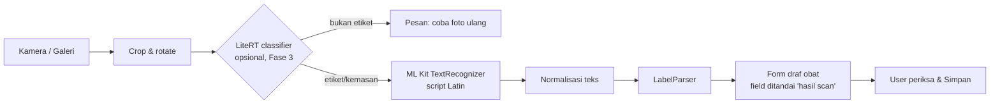

# 06 — Scan Etiket (ML Kit OCR + LiteRT opsional)

## 1. Cakupan
- ✅ Etiket/label cetak dari apotek, kemasan/strip obat.
- ❌ Resep tulisan tangan dokter (hanya disimpan sebagai foto lampiran).
- Hasil scan **selalu** menjadi draf yang diperiksa pengguna.

## 2. Pipeline



## 3. Paket
```yaml
google_mlkit_text_recognition: ^latest
image_picker: ^latest
image_cropper: ^latest
flutter_litert: ^latest        # hanya jika classifier dipakai
```
- ML Kit hanya Android & iOS. Model Latin sudah dibundel; tidak perlu download tambahan.
- Android: `minSdkVersion` mengikuti persyaratan package (cek README terbaru).
- iOS: tambahkan `NSCameraUsageDescription` dan `NSPhotoLibraryUsageDescription` (Bahasa Indonesia).

## 4. Normalisasi
- Gabungkan blok ML Kit per baris, urutkan berdasarkan posisi (atas → bawah, kiri → kanan).
- Lowercase untuk pencocokan, simpan teks asli untuk ditampilkan.
- Perbaikan OCR umum: `0↔o` di dalam angka, `l↔1` di dalam angka, `rng→mg`, `m g→mg`.

## 5. Aturan parser (`LabelParser`)
| Field | Pola (contoh) | Contoh input |
|---|---|---|
| Kekuatan | `(\d+(?:[.,]\d+)?)\s?(mg|mcg|g|ml|iu)` | "Amlodipine 10 mg" |
| Frekuensi | `(\d)\s?[xX×]\s?(?:sehari|1|\d)` / `(\d)\s?dd\s?(\d)` | "3 x 1", "3x sehari 1 tablet", "2dd1" |
| Jumlah per dosis | `(\d+(?:[.,]\d+)?|½|1/2)\s?(tablet|tab|kapsul|kaps|sdt|sdm|ml|tetes)` | "1/2 tablet" |
| Relasi makan | `(sebelum|sesudah|setelah|bersama)\s+makan`, `a\.?c\.?`, `p\.?c\.?` | "sesudah makan" |
| Bila perlu | `bila perlu|jika perlu|p\.?r\.?n` | "bila perlu nyeri" |
| Nama obat | baris dengan skor tertinggi: kata kapital + diikuti kekuatan; cocokkan kamus nama generik lokal (`assets/drug_names.txt`) via fuzzy (Levenshtein ≤ 2) | "AMLODIPINE BESILATE 10MG" |

Output:
```dart
@freezed
class ParsedLabel with _$ParsedLabel {
  const factory ParsedLabel({
    String? name,
    String? strength,
    int? timesPerDay,
    double? doseQty,
    String? form,
    MealRelation? mealRelation,
    bool? isPrn,
    required String rawText,
    required Map<String, double> confidence, // per field 0..1
  }) = _ParsedLabel;
}
```
- `timesPerDay` → template jam default: 1x=07:00, 2x=07:00/19:00, 3x=07:00/13:00/19:00, 4x=06:00/12:00/18:00/22:00.
- Field dengan confidence < 0.6 dikosongkan, bukan ditebak.

## 6. Kamus nama obat
- `assets/drug_names.txt`: daftar nama generik (bukan rekomendasi; hanya untuk koreksi ejaan OCR).
- Sumber harus dicantumkan di `assets/ATTRIBUTION.md` (misalnya daftar dari data publik BPOM/Fornas).
- Tidak menampilkan indikasi atau dosis dari kamus ini.

## 7. LiteRT classifier (opsional, Fase 3)
- Tujuan: menolak foto yang bukan etiket/kemasan sebelum OCR, mengurangi hasil sampah.
- Model: image classifier 3 kelas (`label`, `package`, `other`), input 224×224, kuantisasi int8, < 5 MB.
- Latih dengan TensorFlow / Keras transfer learning (MobileNetV3) atau Google Model Maker, ekspor `.tflite`.
- Simpan di `assets/models/label_classifier.tflite` + `labels.txt`.
- Jalankan di isolate (`IsolateInterpreter`) agar UI tidak tersendat.
- Threshold: jika `other` > 0.7 → minta foto ulang; selain itu lanjut OCR.
- Fitur ini boleh dimatikan lewat remote flag tanpa merusak alur scan.

## 8. Test
- `test/scan/label_parser_test.dart` dengan ≥ 30 contoh teks etiket nyata (anonimkan nama pasien/apotek).
- Golden set gambar di `test/fixtures/labels/` untuk integration test OCR di perangkat.

## 9. Catatan implementasi (T2.9)
- `image_cropper` belum dipakai: foto dari `image_picker` langsung ke ML Kit. Foto dihapus setelah dibaca.
- `LabelParser` murni Dart (52 test). Field di bawah confidence 0,6 dikosongkan; kamus nama obat belum diverifikasi (lihat `assets/ATTRIBUTION.md`).
- T3.3: `LabelClassifier` (`lib/features/scan/domain/label_classifier.dart`) dipanggil sebelum OCR; `other` > 0,7 melempar `NotALabelException` ("coba foto ulang"). Implementasi default `NoModelClassifier` meloloskan semua foto sampai `label_classifier.tflite` dilatih dan `flutter_litert` ditambahkan.
- Form menandai field hasil scan dengan latar `warning-soft` + ikon + teks "Periksa kembali" sampai disentuh, dan menyimpan `source = 'scan'`.
