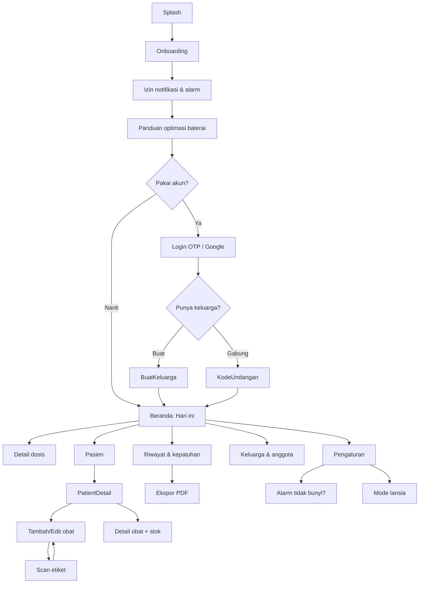

# 07 — Alur Layar & UI

## 1. Peta navigasi

Bottom navigation: **Hari ini · Pasien · Riwayat · Keluarga**. Pengaturan lewat ikon di app bar.

## 2. Spesifikasi layar

### Beranda "Hari ini"
- Filter chip pasien (Semua / Ayah / Ibu).
- Timeline dosis hari ini, dikelompokkan per jam.
- Kartu dosis: foto obat, nama + kekuatan, jumlah, instruksi, status (akan datang / sekarang / terlewat / diminum).
- Swipe atau tombol "Sudah minum". Long-press → Lewati/Catatan.
- Banner peringatan: izin alarm mati, optimasi baterai aktif, stok menipis.
- Empty state: "Belum ada obat. Tambahkan obat pertama →".

### Form obat
Urutan field: Foto (opsional) → Nama* → Kekuatan → Bentuk → Jumlah per dosis* → Frekuensi (chip 1x/2x/3x/4x/Custom/Bila perlu)
→ Jam (otomatis, bisa diubah) → Hari → Relasi makan → Tanggal mulai/selesai → Stok saat ini → Pengingat stok → Catatan.
- Tombol "Scan etiket" di atas form.
- Field hasil scan diberi latar `warning-soft` + ikon `auto_awesome` + label teks "Periksa kembali" sampai disentuh pengguna.
- Validasi: nama tidak kosong, minimal satu jam (kecuali bila perlu), dose_qty > 0.

### Riwayat
- Kalender bulanan: setiap hari memakai warna + ikon + label (untuk pembaca layar): semua diminum (`success`, ikon centang),
  sebagian (`warning`, ikon setengah), ada terlewat (`danger`, ikon tanda seru), tidak ada jadwal (netral, tanpa ikon). Sertakan legenda.
- Persentase kepatuhan 7/30 hari per pasien & per obat.
- Tombol "Ekspor PDF untuk dokter" → pilih pasien + rentang tanggal.

### Keluarga
- Daftar anggota + peran. Owner: undang (tampilkan kode + share sheet), ubah peran, keluarkan.
- Toggle per anggota: "Beri tahu saya jika dosis terlewat".

### Mode lansia
- Font dasar 22sp, tombol tinggi minimal 64dp, satu aksi utama per layar.
- Beranda hanya menampilkan dosis berikutnya dalam kartu besar + satu tombol utama "Sudah minum" (warna `primary`, ikon + label, bukan huruf kapital semua).
- Alarm full-screen dengan foto obat besar.

## 3. Design system ringkas

> Sumber token warna dan tipografi: `docs/00-BRAND-IDENTITY.md` §3–4 (draf; kontras wajib diuji di T0.2b dengan skill
> `ui-ux-pro-max` dan `frontend-design`, lalu perbarui dokumen ini).
> Batasan yang tidak boleh berubah: kontras WCAG AA, target sentuh ≥ 48dp, status tidak hanya dibedakan warna.

| Token | Nilai |
|---|---|
| Primary | Teal `#0F766E` (tenang, hangat; bukan kesan klinis) |
| Success / Warning / Danger | `#15803D` / `#B45309` / `#B91C1C` (nilai brand; `#16A34A`, `#D97706`, `#DC2626` ditinggalkan karena kontras teks di atas putih kurang) |
| Warna lain | `primary-dark`, `primary-soft`, `background`, `surface`, `surface-subtle`, `text-*`, `border`, `info`: lihat brand §3 |
| Radius | 12 (kartu), 24 (tombol besar) |
| Font | Plus Jakarta Sans (fallback Inter), dibundel sebagai asset, bukan diunduh saat runtime (offline-first) |
| Spacing | kelipatan 4 |
| Dark mode | Ada; palet di bawah (diuji otomatis di `test/app/theme/contrast_test.dart`) |

Palet dark (T0.2b): `background #121D1B`, `surface #1A2927`, `surface-subtle #223532`, `text-primary #E8F1EE`,
`text-secondary #AFC2BD`, `border #36514C`, `primary #5BC0B3` (teks di atasnya `#08201D`), `primary-dark #3FA89B`,
`primary-soft #1F3B37`, `success #6FCF8E`, `warning #F2A65A`, `danger #F28B82`, `info #8AB4FF`, `warning-soft #3A2E17`.

Catatan kontras: `warning` (#B45309) di atas `warning-soft` light hanya 4,41:1, jadi teks di atas `warning-soft`
memakai `text-primary`, bukan `warning`. Garis pinggir input memakai `text-secondary` (≥ 3:1), bukan `border`
(`border` hanya pemisah dekoratif). Implementasi: `lib/app/theme/` (`AppPalette`, `AppTokens`, `AppTheme`).

Gunakan Material 3 (`useMaterial3: true`) dengan `ColorScheme.fromSeed`.
Status jangan hanya dibedakan warna: selalu disertai ikon + teks (aksesibilitas).

## 4. Microcopy
| Situasi | Teks |
|---|---|
| Alarm | "Waktunya minum obat, Pak Budi" |
| Konfirmasi | "Tercatat. Amlodipine diminum 07:03" (+ ikon centang) |
| Terlewat (caregiver) | "Ayah belum minum Amlodipine (jadwal 07:00)" |
| Stok | "Clopidogrel tinggal 3 hari lagi. Jangan lupa tebus resep." |
| Izin alarm mati | "Alarm mungkin tidak berbunyi tepat waktu. Aktifkan izin alarm →" |

## 5. Status implementasi layar (per Fase 2)
| Layar | Status | Catatan |
|---|---|---|
| Onboarding (disclaimer, persetujuan, izin, panduan baterai) | ada | persetujuan tidak pre-checked; izin opsional: DND dan layar penuh |
| Hari ini | ada | filter pasien, banner izin & stok, "Sudah minum" + menu "Lewati" |
| Detail dosis (`/dose/:scheduleId?at=`) | ada | dibuka dari notifikasi |
| Pasien, detail pasien, form pasien | ada | kondisi hanya label |
| Form obat | ada | ringkasan konfirmasi sebelum simpan; tombol **Scan etiket**; field hasil scan ditandai "Periksa kembali" |
| Detail obat + stok | ada | tambah stok, sisa hari |
| Riwayat | ada | kalender, kepatuhan 7/30 hari, **Ekspor PDF untuk dokter** (ikon PDF di app bar) |
| Keluarga | ada | masuk akun, buat/gabung keluarga, anggota, undangan (kode + bagikan), peran, "Beri tahu saya", status sync |
| Masuk (`/login`) | ada | email: tautan ke `kizuvia://login-callback` (butuh Redirect URL di Supabase) atau kode 6 digit bila template email memuat `{{ .Token }}` |
| Gabung (`/family/join`, `/invite/:code`) | ada | konfirmasi bila ada data lokal yang akan dibagikan |
| Pengaturan | ada | mode lansia (font & tombol), privasi layar kunci, "Alarm tidak bunyi?"; *debug*: Uji alarm, Gallery |
| Mode lansia penuh (beranda satu kartu, alarm full-screen) | ada | T3.1; kartu = dosis `now`, lalu `upcoming` terdekat, lalu `missed`; foto obat besar di kartu dan di `/dose/:id` |
| Tentang kondisi (`/patients/:id/education`) | ada | T3.2; ikon buku di detail pasien; info umum + sumber + disclaimer |
| Kunci aplikasi | ada | T3.5; layar kunci menutup app, kecuali `/dose/...` |
| Widget home screen "dosis berikutnya" | ada | T3.4, Android |
| Bahasa Inggris | ada | T3.6; mengikuti bahasa perangkat |
| Login Google | belum | ditunda |

Microcopy tambahan Fase 2 (semua di `lib/l10n/app_id.arb`): kode undangan "Berlaku 7 hari dan hanya bisa dipakai sekali.";
scan "Hasil scan hanya draf. Periksa sebelum menyimpan."; push caregiver "{pasien} belum minum {obat} (jadwal HH:mm)".
